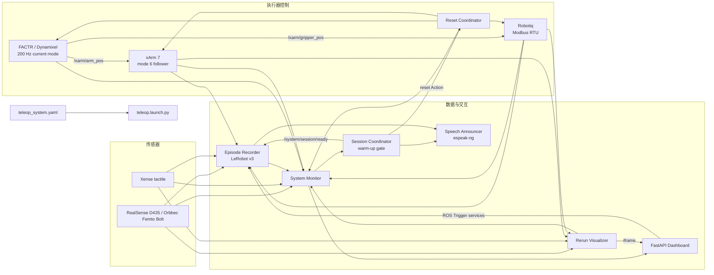

# control_robot 代码导览与修改手册

> 适用版本：2026-07-19 当前工作区源码。本文以实际 `setup.py`、`teleop.launch.py`、YAML、节点实现和测试为准。

## 1. 先说结论

这个工作区是一套“FACTR 主臂控制 xArm 7，从同一个 ROS 2 系统采集相机、触觉和机器人状态，并按 LeRobot v3 录制”的程序。

仓库刻意只保留两个 ROS 2 包：

- `factr_teleop`：保留 FACTR 上游代码、Dynamixel 底层驱动和旧示例。当前主系统只直接复用其中的 `DynamixelDriver`。
- `xarm_ros2_teleop`：当前实际运行的主包，包含遥操作、xArm、Robotiq、相机、触觉、复位、录制、监控、Rerun 和 Web Dashboard。

系统只有一个公开启动入口：

```bash
ros2 launch xarm_ros2_teleop teleop.launch.py \
  config:=config/teleop_system.yaml
```

所有功能均由 [`teleop_system.yaml`](../xarm_ros2_teleop/config/teleop_system.yaml) 控制，不需要也不应该再为相机、触觉、录制或 Dashboard 增加独立 launch。

## 2. 运行架构



最重要的边界是：

- `teleop.launch.py` 只负责配置、进程组织和退出策略，不处理图像或控制算法。
- 每个硬件节点只负责自己的设备与 ROS 接口。
- `reset_coordinator` 通过 ROS 接口协调三类执行器，本身不直接打开硬件。
- `episode_recorder` 是唯一录制状态机和数据落盘入口。
- `session_coordinator` 只负责 warm-up 和 READY 门禁，不写数据集。
- `speech_announcer` 串行执行本地语音请求，TTS 故障不会阻塞 ROS 回调。
- Dashboard、终端键盘都只调用录制器的 ROS 服务。
- Rerun 独立订阅原始 ROS 话题，不参与录制同步，也不影响落盘。

## 3. 推荐阅读顺序

第一次接手代码时，按下面顺序阅读会最快：

1. [`config/teleop_system.yaml`](../xarm_ros2_teleop/config/teleop_system.yaml)：知道当前启用了什么硬件和功能。
2. [`launch/teleop.launch.py`](../xarm_ros2_teleop/launch/teleop.launch.py)：知道 YAML 最终启动了哪些进程。
3. [`system/config.py`](../xarm_ros2_teleop/xarm_ros2_teleop/system/config.py)：知道配置约束和跨组件依赖。
4. [`teleop/leader_node.py`](../xarm_ros2_teleop/xarm_ros2_teleop/teleop/leader_node.py)、[`xarm/xarm_controller.py`](../xarm_ros2_teleop/xarm_ros2_teleop/xarm/xarm_controller.py)、[`robotiq/robotiq_controller.py`](../xarm_ros2_teleop/xarm_ros2_teleop/robotiq/robotiq_controller.py)：理解正常遥操作链路。
5. [`reset/reset_coordinator.py`](../xarm_ros2_teleop/xarm_ros2_teleop/reset/reset_coordinator.py)：理解 episode 之间和 error 后的复位。
6. [`recording/episode_recorder.py`](../xarm_ros2_teleop/xarm_ros2_teleop/recording/episode_recorder.py) 与 [`recording/synchronizer.py`](../xarm_ros2_teleop/xarm_ros2_teleop/recording/synchronizer.py)：理解数据集如何形成。
7. 最后看 `monitor/`、`visualization/` 和 `dashboard/`，它们不应改变核心控制和录制语义。

## 4. 仓库目录与职责

```text
src/
├── AGENTS.md                         # 本仓库代码风格
├── pyproject.toml / uv.lock          # Python 3.10 uv 环境
├── scripts/                          # 环境、udev、第三方补丁脚本
├── factr_teleop/                     # FACTR 上游兼容包 + Dynamixel 驱动
└── xarm_ros2_teleop/
    ├── config/
    │   ├── teleop_system.yaml        # 整个系统唯一主配置
    │   └── gello_grav_comp_demo.yaml # FACTR 控制器参数
    ├── launch/teleop.launch.py       # 唯一公开 launch
    ├── urdf/                         # Pinocchio 使用的 FACTR 动力学模型
    ├── test/                         # 纯逻辑/假硬件测试
    └── xarm_ros2_teleop/
        ├── system/                   # 主 YAML dataclass 与校验
        ├── teleop/                   # 当前 FACTR 控制器和 leader ROS 节点
        ├── xarm/                     # xArm SDK 节点
        ├── robotiq/                  # pyRobotiqGripper RTU 节点
        ├── reset/                    # 双向复位状态机与关节映射
        ├── camera/                   # 官方相机驱动 launch action 工厂
        ├── tactile/                  # Xense 节点和 launch action 工厂
        ├── recording/                # 同步、状态机和 LeRobot writer
        ├── session/                  # warm-up、默认位 reset 和录制门禁
        ├── speech/                   # 本地队列式语音播报
        ├── monitor/                  # 设备新鲜度与系统诊断
        ├── visualization/            # Rerun 实时可视化
        └── dashboard/                # FastAPI、ROS gateway 和静态页面
```

### `factr_teleop` 与当前主实现的关系

这里最容易改错文件：

- 当前 launch 的 `factr_teleop_node` 指向 `xarm_ros2_teleop.teleop.leader_node:main`。
- 当前 FACTR 控制基类是 `xarm_ros2_teleop/teleop/controller.py`。
- 该控制基类从 `factr_teleop.dynamixel.driver` 导入 `DynamixelDriver`。
- `factr_teleop/factr_teleop.py`、旧 ROS2 适配、Franka ZMQ 示例和重力补偿 demo 是上游/兼容代码，不在主 launch 运行路径上；其中旧代码仍依赖工作区外的 `python_utils`。
- `factr_teleop/dynamixel/python/` 是随上游保留的 Dynamixel SDK 源码和示例；当前 uv 环境实际锁定 `dynamixel-sdk` 包。

因此，修改当前 xArm 遥操作算法应优先改 `xarm_ros2_teleop/teleop/`；只有修改串口寄存器访问、力矩到电流映射或电流裁剪时才改 `factr_teleop/dynamixel/driver.py`。

## 5. 启动流程与进程退出策略

`teleop.launch.py` 的实际顺序是：

1. 解析绝对配置路径，或用 `ament_index_python` 将相对路径解析到安装后的 package share。
2. 调用 `load_system_config()` 完整校验 YAML。
3. 若启用 FACTR，额外检查配置中的串口设备路径是否存在。
4. 根据开关创建 xArm、FACTR、Robotiq、reset、相机、触觉、recorder、monitor、Rerun 和 Dashboard 进程。
5. 每台相机与触觉设备按自己的绝对 `startup_delay_sec` 独立启动；配置通过错峰避免 USB 同时打开，但一台设备故障不会阻塞后续设备。
6. System Monitor 以所有配置输出 topic 为唯一 readiness 来源；warm-up 等待 FACTR、xArm、Robotiq 和选中传感器稳定，再 reset 到默认位、稳定等待并解锁操作。

退出策略不是全部相同：

| 进程 | 退出后行为 |
|---|---|
| FACTR leader | 预期的运行期串口故障由节点内部重连，不退出；只有未处理的软件错误或进程退出才关闭整个 launch |
| 相机/触觉 | 驱动进程本地重启；System Monitor 按 `required` 报 ERROR 或 WARN |
| Episode recorder | 关闭整个 launch，避免系统继续运行却不录数据 |
| Monitor / Rerun / Dashboard | 只记录日志，遥操作和录制继续 |
| xArm / Robotiq / reset | 关闭整个 launch，避免执行器或复位协调缺失时继续运行 |

YAML 校验发生在任何进程真正启动前。不要在节点里重复实现已经属于跨组件配置的校验。

五传感器单独验收使用 `sensors.launch.py` 和 `config/sensors_all.yaml`。这个入口只会
构造三台相机、两台触觉、System Monitor、Rerun 和 Dashboard；配置校验会拒绝任何
启用了 FACTR、xArm、Robotiq、reset、录制、推理、RL 或 warm-up 的替代 YAML。

### Console scripts 与真实入口

ROS 2 执行名在 [`xarm_ros2_teleop/setup.py`](../xarm_ros2_teleop/setup.py) 中注册：

| executable | Python 入口 | 主 launch 是否使用 |
|---|---|---|
| `factr_teleop_node` | `teleop.leader_node:main` | 是 |
| `xarm_node` | `xarm.xarm_controller:main` | 是 |
| `robotiq_node` | `robotiq.robotiq_controller:main` | 是 |
| `reset_node` | `reset.reset_coordinator:main` | `reset.enabled` 时 |
| `tactile_node` | `tactile.xense_publisher:main` | 每台启用 Xense 一个进程 |
| `episode_recorder` | `recording.episode_recorder:main` | `recording.enabled` 时 |
| `session_coordinator` | `session.session_coordinator:main` | `warmup.enabled` 时 |
| `speech_announcer` | `speech.speech_announcer:main` | warm-up 或录制启用，且 speech 启用时 |
| `system_monitor` | `monitor.system_monitor:main` | Dashboard 或 warm-up 启用时 |
| `rerun_visualizer` | `visualization.rerun_visualizer:main` | Dashboard 和 Rerun 都启用时 |
| `dashboard_server` | `dashboard.server:main` | `dashboard.enabled` 时 |

launch 给这些 Python 节点加了 `prefix=[sys.executable]`，目的是让它们使用启动 `ros2 launch` 时所在的 uv Python，而不是意外落到另一个 Python 环境。

## 6. 主 YAML

[`teleop_system.yaml`](../xarm_ros2_teleop/config/teleop_system.yaml) 是系统事实来源：

| 顶层字段 | 控制内容 | 主要读取方 |
|---|---|---|
| `system` | 系统显示名称 | launch、Dashboard |
| `teleop` | FACTR 启动、offset 文件和 FACTR↔xArm 参考姿态 | launch、配置校验 |
| `xarm` | IP、控制周期、状态频率、速度/加速度、初始化位 | xArm、reset |
| `robotiq` | RTU 端口、ID、速度、力、控制周期 | Robotiq |
| `reset` | Action、超时、稳定判据、FACTR 低电流 PD | coordinator、FACTR |
| `cameras` | 相机列表、序列号、统一话题、数据流 | camera factory、monitor |
| `tactile` | Xense 列表、序列号、输出开关 | tactile node、monitor |
| `recording` | LeRobot 目录、episode、同步、视频流 | recorder、Rerun |
| `warmup` | 传感器启动间隔、就绪稳定时间、超时和解锁延时 | launch、session |
| `speech` | 本地命令、音色、语速、音量和各阶段文案 | speech、session、recorder |
| `dashboard` | Web、日志、Rerun 端口和资源限制 | monitor、Rerun、Web |

关键跨组件约束：

- `reset.enabled=true` 要求 teleop、xArm、Robotiq 都启用；xArm 固定使用 `/xarm/...` 接口。
- `warmup.enabled=true` 要求 reset 启用；warm-up 不依赖 recording 开关，普通遥操作启动也会自动归位。
- 录制要求 xArm 和 Robotiq 启用；如果录制前后需要 reset，还要求 `reset.enabled=true`。
- 录制流必须来自当前已启用且确实生成该输出的相机/触觉节点。
- `recording.anchor.key` 必须指向启用的 RGB 相机流，录制 FPS 固定为 30；流名称应与相机逻辑名称一致。
- Dashboard 仅允许绑定 `127.0.0.1` 或 `localhost`，三个端口必须互不冲突。
- 相机和触觉的 `name`、`topic_prefix` 全局不能重复；同类硬件序列号不能重复。

### 当前默认开关

当前主 YAML 中：

- FACTR、xArm、Robotiq、reset、warm-up、Dashboard、Rerun 为启用；
- cameras、tactile、recording 为关闭；
- 设备定义和录制流仍保留在 YAML 中，打开总开关后使用。

## 7. 执行器控制

### 7.1 FACTR / Dynamixel

主要文件：

- [`teleop/controller.py`](../xarm_ros2_teleop/xarm_ros2_teleop/teleop/controller.py)：控制算法和硬件初始化。
- [`teleop/leader_node.py`](../xarm_ros2_teleop/xarm_ros2_teleop/teleop/leader_node.py)：ROS 通信和 reset 对齐。
- [`teleop/offset_calibration.py`](../xarm_ros2_teleop/xarm_ros2_teleop/teleop/offset_calibration.py)：持久化 encoder offset 和参考姿态映射。
- [`factr_teleop/dynamixel/driver.py`](../factr_teleop/factr_teleop/dynamixel/driver.py)：Dynamixel 读写。
- [`gello_grav_comp_demo.yaml`](../xarm_ros2_teleop/config/gello_grav_comp_demo.yaml)：200 Hz 控制参数。

正常控制循环：

1. 读取 8 个 Dynamixel 的位置和速度，前 7 个是手臂，第 8 个是触发式夹爪。
2. 用持久化的 encoder offset 和 `joint_signs` 转成逻辑关节方向。
3. 计算关节限位力矩。
4. 可选叠加 null-space、重力补偿、静摩擦补偿和力反馈。
5. 将逻辑力矩再次乘 `joint_signs` 后转换成电流。
6. 正常遥操作使用驱动的 `±900 mA` 上限；reset 使用 YAML 的较低单次上限，当前为 `±150 mA`。
7. 发布 leader 相对原点的 7 轴增量和夹爪位置。

必须保留的物理语义：

- Dynamixel 工作在 operating mode `0`，即 current control mode。
- `joint_signs` 同时影响测量方向和最终电流方向。
- `DynamixelDriver.set_current()` 的物理硬上限始终不超过 `±900 mA`。
- reset PD 目标每个 200 Hz 周期最多变化 `factr_target_step_rad`，避免一步跳到目标。
- reset 状态过期时不再叠加位置 PD，只保留重力补偿和限位保护。

历史配置中的 `current_signs`、`current_limit_ma`、`controlled_ids`、`allow_arbitrary_offsets` 没有运行代码读取，现已从当前 FACTR YAML 删除。实际方向和限流来自 `joint_signs`、正常 `900 mA` 驱动上限和 reset 的 `factr_max_current_ma`。如果未来要重新引入独立 current signs 或普通控制限流，需要同时补充配置校验、实现和测试，不能只增加 YAML 字段。

200 Hz 控制前应单独检查 FTDI latency timer；脚本默认读取当前 FACTR YAML 的串口：

```bash
./scripts/diagnostics/check_factr_latency.sh
# 如果不是 1：
./scripts/diagnostics/check_factr_latency.sh --set
```

#### FACTR offset 与遥操作原点

`teleop.offset_file` 默认是 `~/.config/control_robot/offset.yaml`。它保存 8 个 Dynamixel 的物理 encoder offset、标定原始/逻辑读数、current operating mode，以及 FACTR/xArm 同物理姿态参考对；不会在 reset 后改写，因此不会积累运行时重定基误差。FACTR reference 使用人工匹配时实际测得的逻辑角，而不是要求摆到的理想数值，因此 schema 2 的已有标定可以保留人工匹配结果。

FACTR 的启动目标不是直接采用首次人工摆放时读到的角度，而是每次启动都由一对“同一物理姿态”的参考关节角反推：

```text
factr_home = factr_reference
             + xarm_to_factr_signs * (xarm.initial_joint_positions - xarm_reference)
```

其中参考姿态由标定命令写入 `offset.yaml`：

- `factr_reference_joint_positions_rad`：参考物理姿态下的 FACTR 7 轴逻辑角；
- `xarm_reference_joint_positions_rad`：同一物理姿态下的 xArm 7 轴绝对角；
- `xarm_to_factr_signs`：从 `teleop_system.yaml` 取得并随标定保存，只能是 `-1` 或 `1`。

因此，修改 `xarm.initial_joint_positions` 后，FACTR home 会按关节差自动更新，不需要重新采集 encoder offset。`dynamixel.joint_signs` 是原始舵机读数/电流的方向，和跨机械臂的 `xarm_to_factr_signs` 是两个不同概念。

首次运行或重新装配后，先停止主 launch，再运行独立标定命令：

```bash
ros2 run xarm_ros2_teleop factr_calibrate
```

标定工具先清除可恢复的 xArm error，并将 xArm 移动到 `xarm.initial_joint_positions`。随后它关闭 FACTR torque、切换并校验与正式运行一致的 current operating mode `0`，再提示把 FACTR 手动摆到对应物理姿态；其逻辑目标来自 `arm_teleop.initialization.start_joints`，共 7 个臂关节加张开夹爪。确认后，工具选择每个臂关节最近的 π/2 encoder 展开，显示原始位置、逻辑位置和逐关节误差，并在人工输入 `yes` 后以 schema 2 原子覆盖 `offset.yaml`。默认任一臂关节误差超过 `0.35 rad` 或 xArm 到位误差超过 `0.03 rad` 时拒绝保存。

主 launch 不再兼任标定；缺少 offset、旧 schema、operating mode 不一致或映射不一致时，会在启动任何硬件前报错。正常运行从 `offset.yaml` 加载 encoder offset 和参考映射。FACTR 从节点启动到 warm-up 解锁前始终使用低电流 PD 加重力补偿保持参考位置，xArm 到位后再切换到其实际位置对应的 FACTR 目标；PD 输出仍受 `factr_max_current_ma` 硬限流。更换舵机、改变串口设备、修改任一方向映射或重新装配后，重新执行标定命令并覆盖旧文件。

### 7.2 xArm 7

主要文件：[`xarm/xarm_controller.py`](../xarm_ros2_teleop/xarm_ros2_teleop/xarm/xarm_controller.py)。

启动动作：

1. `XArmAPI(..., do_not_open=True)` 后显式连接 IP。
2. `motion_enable(true)`、mode 0、state 0。
3. 普通模式下阻塞移动到 `xarm.initial_joint_positions`；warm-up 模式只连接，不提前运动。
4. 切到 mode 6、state 0，进入在线关节跟随。

正常目标为：

```text
xarm_absolute_target = xarm.initial_joint_positions + factr_delta
```

xArm 节点固定使用 7 轴、弧度制和 `/xarm/...` 话题，不再暴露与系统其他部分矛盾的轴数、角度单位或命名空间参数。控制定时器默认 100 Hz，下发 `set_servo_angle(wait=False)`，使用 YAML 中的最大关节速度和加速度。另一个独立定时器默认 60 Hz 读取 error/warn 和关节状态；读取失败时不重发旧状态，`/xarm/control_ok` 会变为 false。

xArm error 的处理分两层：

- xArm 节点负责 `clean_error()`、等待 1 秒、重新启用 motion/mode 6/state 0。
- reset coordinator 看到 error 后负责选择最近稳定安全位、打开 Robotiq、对齐 FACTR，并在完整 reset 成功后恢复正常遥操作。

reset 期间普通 leader 消息被忽略；reset 退出后必须收到一条新的 leader 消息才恢复运动，避免执行复位前缓存。
warm-up 模式下 `/system/session/ready=false` 也会阻止普通 leader 跟随，初始位置由传感器就绪后的 reset Action 到达。

### 7.3 Robotiq

主要文件：[`robotiq/robotiq_controller.py`](../xarm_ros2_teleop/xarm_ros2_teleop/robotiq/robotiq_controller.py)。

它不经过 xArm 工具端口，而是用 `pyrobotiqgripper` 直接连接 `/dev/robotiq_rs485`，RTU device ID 当前为 9。构造后先读取 activated/started 状态：已经激活时只补发必要的 `start()`；冷启动未激活时才执行 `reset` 和完整 activation。冷启动等待时间由 `robotiq.activation_timeout_sec` 配置，默认 15 秒，因此普通 ROS 节点重启不会重复开合标定。

leader 夹爪的弧度映射为：

```text
robotiq_bits = clip(-leader_gripper_rad * 255, 0, 255)
```

其中 0 是完全打开，255 是完全闭合。小于 `minimal_motion` bit 的变化不重复写 Modbus。reset active 时忽略普通指令并持续以 `move(0, wait=False)` 打开；reset 结束时清空旧目标。

## 8. 相机节点

主要文件：[`camera/driver_actions.py`](../xarm_ros2_teleop/xarm_ros2_teleop/camera/driver_actions.py)。这个模块不是图像节点，而是供主 launch 调用的官方驱动 action 工厂。

支持：

- RealSense D435：`realsense2_camera_node`。
- Orbbec Femto Bolt：`orbbec_camera::OBCameraNodeDriver` component。

每台相机按唯一序列号绑定，不允许回退连接其他设备。对外接口统一为：

| 话题 | 类型 | 说明 |
|---|---|---|
| `/<prefix>/color` | `sensor_msgs/Image` | RGB 图像 |
| `/<prefix>/color/camera_info` | `sensor_msgs/CameraInfo` | 彩色内参 |
| `/<prefix>/depth` | `sensor_msgs/Image` | 对齐到 color 的深度 |
| `/<prefix>/depth/camera_info` | `sensor_msgs/CameraInfo` | 深度内参 |
| `/<prefix>/point_cloud` | `sensor_msgs/PointCloud2` | 彩色 XYZRGB 点云 |

流开关的含义是“让厂商驱动不生成数据”，不是生成后再丢弃：

- depth 要求 color 显式开启。
- point cloud 要求 color、depth、point cloud 都显式开启。
- D435 使用 `align_depth.enable` 与 `pointcloud.enable`。
- Femto Bolt 使用 `depth_registration`、硬件 COLOR 对齐和 `enable_colored_point_cloud`。

话题通过 remap 直连，不经过 Python relay。TF/frame 名使用相机 `name` 防止多设备冲突。

## 9. Xense 触觉节点

主要文件：

- [`tactile/driver_actions.py`](../xarm_ros2_teleop/xarm_ros2_teleop/tactile/driver_actions.py)：创建一个序列号对应一个进程的 launch action。
- [`tactile/xense_publisher.py`](../xarm_ros2_teleop/xarm_ros2_teleop/tactile/xense_publisher.py)：SDK 采集和 ROS 转换。

启动时先 `Sensor.scanSerialNumber()`，只有目标序列号存在才 `Sensor.create(serial, check_serial=True)`。所有启用输出在一次 `selectSensorInfo(...)` 中采集，保证属于同一物理帧。设为 false 的输出不会传给 SDK，因此不会产生该数据。

| YAML 输出 | ROS 类型 | 数据形态/单位 |
|---|---|---|
| `rectify` | `sensor_msgs/Image` | `bgr8`, `(H,W,3)` |
| `difference` | `sensor_msgs/Image` | `bgr8`, `(H,W,3)` |
| `depth` | `sensor_msgs/Image` | `32FC1`, `(H,W)`，SDK 原生 mm |
| `marker_2d` | `Float32MultiArray` | 原始 tensor，shape 写入 `layout.dim` |
| `force` | `Float32MultiArray` | 常见 `(35,20,3)` |
| `force_norm` | `Float32MultiArray` | 常见 `(35,20,3)` |
| `force_resultant` | `Float32MultiArray` | 常见 `(6,)` |

非图像 tensor 按行优先展平。修改 tensor 格式时必须同步修改下游消费者，不能仅改变 `message.data`。

## 10. Reset Coordinator

主要文件：

- [`reset/reset_coordinator.py`](../xarm_ros2_teleop/xarm_ros2_teleop/reset/reset_coordinator.py)：Action server 和状态机。
- [`reset/mapping.py`](../xarm_ros2_teleop/xarm_ros2_teleop/reset/mapping.py)：纯关节映射公式。

公开接口是 `/teleop/reset`，类型为 `control_msgs/action/FollowJointTrajectory`。它只接受：

- `joint1` 到 `joint7`，顺序可不同但不能缺失或重复；
- 恰好一个 trajectory point；
- 7 个有限绝对关节角，单位 rad；
- 只包含 positions，不包含 velocity、acceleration 或 effort。

状态机为：

```text
IDLE
  -> CLEARING_ERROR（存在 xArm error 时）
  -> MOVING_XARM
  -> WAITING_FACTR（串口离线时无超时等待）
  -> ALIGNING_FACTR
  -> COMPLETE
  -> IDLE

任一超时/状态过期/目标非法 -> FAILED（保持 reset 所有权和安全暂停）
```

完整 reset 的物理顺序：

1. `/teleop/reset/active=true`，FACTR→xArm 和普通夹爪控制暂停并清缓存。
2. xArm 节点负责清 error 和恢复 mode 6。
3. xArm 移动到绝对目标，Robotiq 同时打开。
4. xArm 位置和速度连续稳定后，若 FACTR 离线则停在 `WAITING_FACTR`；重连并通过连续读校验后再发布 FACTR 对齐许可。
5. FACTR 用低电流 PD 移到反向映射目标，同时把 leader 夹爪移到打开位置。
6. FACTR 与 Robotiq 都连续稳定后，FACTR 重定基，Action 成功。
7. 释放 reset；xArm 等待 reset 后的新 leader 指令。

反向映射与重定基公式：

```text
factr_target = factr_origin + signs * (xarm_actual - xarm_initial)
factr_origin = factr_actual - signs * (xarm_actual - xarm_initial)
```

第二个公式保证恢复后的第一条 xArm 命令连续。

coordinator 在非 reset 阶段持续记录最近“error=0、control_ok、状态新鲜、速度足够低并稳定”的 xArm 安全位。正常遥操作出现 error 时会自动对该安全位执行同一套 reset；没有历史安全位时使用初始化位。

取消 Action 不会立刻释放控制，而是先让 xArm 保持当前实际姿态、FACTR 对齐当前 xArm，再安全返回 canceled。FAILED 状态允许提交新的 reset 进行恢复。

## 11. LeRobot v3 录制

### 11.1 模块分工

| 文件 | 职责 |
|---|---|
| `recording/config.py` | 校验录制目录、30 FPS、流、同步阈值和 reset 位姿 |
| `recording/timestamp_buffer.py` | 有界时间戳缓存；nearest 和 latest-before 查询 |
| `recording/message_converters.py` | ROS Image/JointState 到 NumPy，RGB、metric depth 和深度预览 |
| `recording/synchronizer.py` | 以配置的主相机为锚拼一行完整数据 |
| `recording/dataset_schema.py` | 从首帧生成固定 LeRobot feature schema |
| `recording/lerobot_writer.py` | 创建/续写、保存、丢弃、finalize 数据集 |
| `recording/keyboard_controller.py` | 直接读取 `/dev/tty` 快捷键 |
| `recording/episode_recorder.py` | 唯一录制状态机、ROS 服务、reset 衔接和 metrics |

### 11.2 时间同步

录制严格以 `recording.anchor.key` 指定流（当前真机 RGB 配置为 `top_camera`）的 ROS 消息时间戳为中心：

- 每个接收的主相机帧形成一个候选数据行。
- 其他 RGB/depth/触觉图像以及 xArm、Robotiq state 保留短的有界历史。
- 主相机帧到达时，按 ROS 时间戳为每一路选择最接近的样本。
- 相机正常同步由硬件保证；图像时间差写入 `observation.sync_skew_s`，但不因差值丢帧。
- state 与主相机的差值超过 `max_state_skew_sec` 时同样丢弃该行。
- xArm 和 Robotiq 的 action 只能选锚点时刻之前最近的命令，禁止用未来 action。
- 任一观测超过对应 skew/age 阈值时只丢弃当前数据行，不终止 episode 或遥操作。
- 完整数据行进入短的有界后台写盘队列；队列满时丢弃最旧行并保留最新观测。

图像/state 使用 `nearest()`；action 使用 `latest_before()`。因此观测尽量贴近锚点，控制标签始终保持因果性。

### 11.3 state 与 action

两者必须保持分开：

| LeRobot feature | shape | 来源 | 物理含义 |
|---|---:|---|---|
| `observation.state` | `(8,)` float32 | xArm 实际 7 轴 + Robotiq 实际归一化位置 | 机器人真实状态 |
| `action` | `(8,)` float32 | xArm 已接受的绝对目标 7 轴 + Robotiq 已下发目标 | 控制命令 |
| `observation.xarm_velocity` | `(7,)` float32 | xArm SDK | 实际 rad/s |
| `observation.xarm_effort` | `(7,)` float32 | xArm SDK | SDK 返回的 effort |
| `observation.sync_skew_s` | `(视频流数+4,)` float32 | synchronizer | 各样本相对 head camera 的秒差 |
| `observation.images.<key>` | `(H,W,3)` uint8 | 配置的图像流 | MP4 视频 feature |
| `task` | scalar string | `recording.instruction` | VLA 自然语言指令，每帧写入 |

xArm action 来自 `/xarm/commanded_joint_state`，只在 SDK 下发成功时发布；不是 FACTR 原始输入。Robotiq action 同理来自实际写给夹爪的命令。

### 11.4 深度视频

LeRobot 当前视频 schema 要求 uint8 三通道图像，因此 depth 录制为固定量程的灰度 RGB MP4：0 表示无效值，1～255 表示 YAML 中 `[depth_min_m, depth_max_m]`。它适合预览和学习输入，但不是无损 metric depth。

Rerun 不使用这份 8-bit 预览，而是把原始深度转成米并显示为 `rr.DepthImage`。如果之后需要无损深度数据集，应新增明确的数据特征/编码方案，不要把当前 MP4 当作可逆格式。

### 11.5 Episode 状态机和控制

```text
WARMUP
  -> IDLE / FAILED
  -> STAGING（可选：开放 FACTR 遥操作但不写入数据）
  -> RECORDING（可从 IDLE 直接开始，或从当前 staged 位姿开始）
  -> FACTR_RECONNECTING / FACTR_RESETTING（运行期断连恢复）
  -> SAVING 或 DISCARDING（写盘与可选录制后 reset 并行）
  -> 等待 write_done && reset_done
  -> IDLE / COMPLETE
  -> FINALIZED
```

| 操作 | 键盘 | ROS 服务 | Web API |
|---|---|---|---|
| 进入预定位 | `G` | `/recording/start_staging` | `POST /api/v1/recording/staging` |
| 开始本条 | `S` | `/recording/start_episode` | `POST /api/v1/recording/start` |
| 保存为 success | `→` | `/recording/stop_episode` | `POST /api/v1/recording/save` |
| 保存为 optimal | `O` | `/recording/save_optimal` | `POST /api/v1/recording/optimal` |
| 保存为 failure | `F` | `/recording/save_failure` | `POST /api/v1/recording/failure` |
| 丢弃本条 | `←` | `/recording/discard_episode` | `POST /api/v1/recording/discard` |
| 结束录制 | `Esc` | `/recording/finalize` | `POST /api/v1/recording/finish` |

warm-up 或 episode reset 完成后，操作者可从 `IDLE` 直接按 `S` 录制，也可按 `G` 进入 `STAGING`。任一路径第一次开放控制时，FACTR 都以当前关节位置重定基，xArm 在收到零增量确认前拒绝队列里的旧命令，因此空闲期间移动 FACTR 不会造成第一帧跳变。`STAGING` 只开放 FACTR→xArm/Robotiq 控制，传感器仍更新最新值但不组帧写盘；随后按 `S` 会清空同步缓存并从当前位姿开始录制，不再次 reset 或重定基。`STAGING` 中按 `←` 只放弃预定位并执行 reset，不创建空 episode。保存或丢弃录制后，LeRobot 的 Parquet/MP4 写盘与 `/teleop/reset` 并行执行；只有写盘和 xArm/FACTR/Robotiq 复位都成功后才允许下一条。任一分支失败时，另一分支仍安全收尾，最终统一进入 `FAILED`。Episode 开始、保存、丢弃和 reset 阶段都会发布语音事件。Esc 在当前条有有效帧时按 `success` 保存，没有有效帧时丢弃，等待写盘与复位后再 finalize。

遥操作界面输入的是分类数据集的父目录。四类轨迹分别保存为可独立加载的 LeRobot 数据集：

```text
<dataset_root>/
├── success/
├── optimal/
├── failure/
└── crash/
```

右箭头、`O` 和 `F` 分别选择前三类；录制期间发生非零 xArm error 时，有有效帧的当前条自动保存到 `crash/` 后进入原有复位流程。目标 episode 数、Web 的“已完成”数量和会话结束条件只统计 `success/`；另外三类只用于收纳，不占 success 配额。

运行期 FACTR 串口故障不会再结束整个录制会话。leader 节点立即发布
`/factr/connected=false`，xArm 的独立指令看门狗也会在 0.25 秒没有新指令时切到
mode 0 原地保持；看门狗状态同时送给 recorder 和 reset coordinator，因此即使 leader
进程没有退出也不会卡在等待对齐。若此时正在 `RECORDING`，当前未完成 episode 会被丢弃；若处于
`STAGING`，只取消预定位。随后 xArm 和 Robotiq 先执行正常 reset，coordinator 在
`WAITING_FACTR` 等待 leader 每秒主动重连。串口恢复后必须连续成功读取 5 次才重新
标记在线，然后完成 FACTR 对齐、重定基和 reset；只有完整流程成功后录制器才回到
`IDLE`。断线期间开始或预定位请求都会被拒绝，已经进入 `SAVING` 的完整 episode
不会因为后续断线而删除。

本地父目录由 YAML 默认值或 Web 会话设置决定，例如：

```text
/home/gxy/datasets/task_name
```

`recording.instruction` 是面向 VLA 的自然语言指令，写入 LeRobot 标准 `task` 字段。旧 YAML 的 `task` 仍可兼容读取，但不能与 `instruction` 配置成不同文本。

每个分类子数据集只有在 FPS 和完整 schema 一致时才允许续写；Overwrite 也只处理这四个明确的子目录，不删除父目录中的其他文件。

## 12. 监控、Rerun 与 Web Dashboard

### 12.1 System Monitor

[`monitor/system_monitor.py`](../xarm_ros2_teleop/xarm_ros2_teleop/monitor/system_monitor.py) 根据 YAML 动态建立 tracker，并发布 `/system/diagnostics`：

- FACTR、xArm、Robotiq：看状态话题新鲜度；xArm 额外综合 `control_ok` 和 error/warn。
- 相机、触觉：要求 YAML 中每一个已启用输出都持续收到消息。
- recording、reset、session、speech、rerun：监控各自状态/心跳。
- disabled 组件显示 `DISABLED`，不是故障。
- required 组件 stale 为 ERROR，optional 组件 stale 为 WARN。

监控表示“ROS 数据是否持续到达”，并不等同于完整硬件自检。例如官方相机驱动没有统一连接状态，因此只能用输出新鲜度判断。

### 12.2 Rerun

[`visualization/rerun_visualizer.py`](../xarm_ros2_teleop/xarm_ros2_teleop/visualization/rerun_visualizer.py) 使用 `recording.streams` 直接订阅：

- RGB/触觉为 `rr.Image`；
- depth 为米单位 `rr.DepthImage`；
- xArm/Robotiq state 与 action 为独立时间曲线；
- recorder/reset 状态和 ROS WARN 以上日志为 TextLog。

所有数据用 ROS 时间戳写到 `ros_time` timeline。它有自己的最大 FPS 和 gRPC 内存上限；最旧可视化数据被回收不会影响 LeRobot 数据集。

### 12.3 Dashboard

Dashboard 分三层：

- [`dashboard/ros_gateway.py`](../xarm_ros2_teleop/xarm_ros2_teleop/dashboard/ros_gateway.py)：ROS diagnostics、`/rosout` 和 recorder service client。
- [`dashboard/server.py`](../xarm_ros2_teleop/xarm_ros2_teleop/dashboard/server.py)：FastAPI、WebSocket、静态文件和 ROS executor 线程。
- [`dashboard/static/`](../xarm_ros2_teleop/xarm_ros2_teleop/dashboard/static/)：无 Node/React/CDN 的 HTML、CSS、JavaScript 页面。

HTTP 接口：

| 接口 | 用途 |
|---|---|
| `GET /` | 蓝白录制控制台 |
| `GET /healthz` | 只表示 Web 进程存活 |
| `GET /api/v1/status` | 当前系统、warm-up、录制、reset、硬件和日志快照 |
| `WS /api/v1/events` | 按 `status_rate_hz` 推送完整快照 |
| `POST /api/v1/recording/start` | 调 recorder start service |
| `POST /api/v1/recording/save` | 调 recorder stop/save service |
| `POST /api/v1/recording/discard` | 调 recorder discard service |
| `POST /api/v1/recording/finish` | 调 recorder finalize service |

默认地址是 `http://127.0.0.1:8080`，Rerun Viewer 通过 iframe 嵌入。Dashboard 不导入 recorder 内部类，因此页面退出、Web 服务异常或 Rerun 异常都不会改变录制器状态。

## 13. ROS 接口总表

### 正常遥操作与状态

| 话题 | 类型 | 发布者 → 订阅者 | 说明 |
|---|---|---|---|
| `/xarm/arm_pos` | `JointState` | FACTR → xArm | 7 轴相对初始化位增量，rad |
| `/xarm/gripper_pos` | `JointState` | FACTR → Robotiq | leader 夹爪角，rad |
| `/factr/arm_joint_state` | `JointState` | FACTR → reset/monitor | 7 轴绝对位置与速度 |
| `/xarm/arm_joint_state` | `JointState` | xArm → reset/record/monitor/Rerun | 实际位置、速度、effort |
| `/xarm/commanded_joint_state` | `JointState` | xArm → recorder/Rerun | SDK 成功接受的绝对目标 |
| `/xarm/error_warn` | `Int32MultiArray` | xArm → reset/monitor | `[error, warning]` |
| `/xarm/control_ok` | `Bool` | xArm → reset/monitor | 最近读取和命令健康状态 |
| `/robotiq/position_bits` | `Int32` | Robotiq → reset | 0 开、255 合 |
| `/robotiq/joint_state` | `JointState` | Robotiq → recorder/monitor/Rerun | 实际归一化位置 `(1,)` |
| `/robotiq/commanded_joint_state` | `JointState` | Robotiq → recorder/Rerun | 已下发归一化目标 `(1,)` |

### Reset 内部接口

以下是 reliable、transient-local 的内部协调接口；外部业务通常只应调用 Action：

| 接口 | 类型 | 说明 |
|---|---|---|
| `/teleop/reset` | `FollowJointTrajectory` Action | 公开复位入口 |
| `/teleop/reset/status` | `String` | IDLE/CLEARING_ERROR/MOVING_XARM/ALIGNING_FACTR/COMPLETE/FAILED |
| `/teleop/reset/active` | `Bool` | reset 是否拥有三类执行器 |
| `/teleop/reset/xarm_target` | `JointState` | 7 轴绝对 xArm 目标 |
| `/teleop/reset/xarm_target_valid` | `Bool` | xArm SDK 关节限位校验结果 |
| `/teleop/reset/align_factr` | `Bool` | 允许 FACTR 主动对齐 |
| `/teleop/reset/factr_aligned` | `Bool` | FACTR 已稳定且完成重定基 |

### Warm-up 与语音接口

| 接口 | 类型 | 说明 |
|---|---|---|
| `/system/session/status` | `String` | WAITING_HARDWARE/RESETTING/SETTLING/ANNOUNCING_READY/READY/FAILED |
| `/system/session/ready` | `Bool` | transient-local 的录制及普通执行器门禁 |
| `/system/announcement/request` | `diagnostic_msgs/KeyValue` | key 为事件 ID，value 为待播报文本 |
| `/system/announcement/finished` | `String` | 已完成或已失败的语音事件 ID |
| `/system/speech/status` | `String` | 本地 TTS 健康和最近播报状态 |

### 录制、诊断与可视化

| 接口 | 类型 | 说明 |
|---|---|---|
| `/recording/status` | `String` | 兼容用简要状态 |
| `/recording/metrics` | `DiagnosticArray` | episode、帧数、时长、目录、按钮可用性、错误 |
| `/recording/*` 四个服务 | `std_srvs/Trigger` | 开始、保存、丢弃、finalize |
| `/system/diagnostics` | `DiagnosticArray` | 所有组件健康快照 |
| `/visualization/rerun/status` | `String` | Rerun 心跳和 server URI |

## 14. 文件索引

下表列出需要维护的功能文件；空 `__init__.py`、mesh、图片等静态资源不逐项展开。

| 路径 | 修改它的场景 |
|---|---|
| `xarm_ros2_teleop/setup.py` | 增加 console script、Python 依赖或安装资源 |
| `xarm_ros2_teleop/package.xml` | 增加 ROS/apt 依赖 |
| `launch/teleop.launch.py` | 新节点的统一启动、参数传递和退出策略 |
| `system/config.py` | 跨组件 YAML schema 和启动前校验 |
| `system/session_config.py` | warm-up 与 speech YAML 校验 |
| `teleop/controller.py` | FACTR 控制律、校准、重力/限位/电流控制 |
| `teleop/leader_node.py` | FACTR ROS 接口、reset 反向对齐和重定基 |
| `teleop/offset_calibration.py` | encoder offset 文件和 FACTR↔xArm 参考映射 |
| `xarm/xarm_controller.py` | xArm SDK 初始化、状态读取、mode 6 指令和清错 |
| `robotiq/robotiq_controller.py` | RTU 连接、激活、位置映射和 reset 打开 |
| `reset/reset_coordinator.py` | reset Action、阶段推进、安全位、超时和取消 |
| `reset/mapping.py` | FACTR↔xArm 纯数学映射 |
| `camera/driver_actions.py` | 厂商参数、remap、启动延迟和进程恢复策略 |
| `tactile/driver_actions.py` | Xense 进程参数、启动延迟和进程恢复策略 |
| `tactile/xense_publisher.py` | Xense SDK 调用、输出类型和 ROS 转换 |
| `recording/config.py` | 录制 YAML 字段与固定约束 |
| `recording/timestamp_buffer.py` | 时间缓存和选择规则 |
| `recording/message_converters.py` | 图像编码、深度单位和 JointState 转换 |
| `recording/synchronizer.py` | state/action/传感器的时间同步语义 |
| `recording/dataset_schema.py` | LeRobot feature shape/dtype |
| `recording/lerobot_writer.py` | 数据集创建、续写、保存和 finalize |
| `recording/keyboard_controller.py` | `/dev/tty` 快捷键解析 |
| `recording/episode_recorder.py` | episode 状态机、服务、reset 衔接、metrics |
| `session/session_coordinator.py` | 执行器/传感器 readiness、初始 reset、READY 门禁 |
| `system/sensor_actions.py` | 汇总启用设备的独立 launch actions，不参与 readiness 判定 |
| `speech/speech_announcer.py` | FIFO 本地 TTS 与完成确认 |
| `monitor/health.py` | 与 ROS 无关的新鲜度判定 |
| `monitor/system_monitor.py` | YAML 到组件 tracker、diagnostics 内容 |
| `visualization/rerun_visualizer.py` | Rerun Blueprint 和 ROS→Rerun 转换 |
| `dashboard/config.py` | Dashboard/Rerun host、端口、内存校验 |
| `dashboard/ros_gateway.py` | ROS→JSON 快照和 Web→ROS 服务调用 |
| `dashboard/server.py` | FastAPI 路由、WebSocket、executor 生命周期 |
| `dashboard/static/index.html` | 页面结构 |
| `dashboard/static/styles.css` | 蓝白视觉样式和布局 |
| `dashboard/static/app.js` | 状态渲染、按钮、快捷键、WebSocket 重连 |
| `factr_teleop/dynamixel/driver.py` | Dynamixel 寄存器、读写和 ±900 mA 物理上限 |
| `scripts/bootstrap.sh` | uv、rosdep 和 colcon 的统一环境流程 |
| `scripts/setup/install_sensor_udev.sh` | RealSense/Orbbec/Xense USB 权限 |
| `scripts/setup/patch_pyrobotiqgripper.sh` | 第三方 3.2.8 缺失 `Optional` import 补丁 |

### 保留但不在主运行路径上的文件

| 路径 | 当前定位 |
|---|---|
| `factr_teleop/factr_teleop/factr_teleop.py` | 原始 FACTR 抽象基类，保留上游实现；仍引用外部 `python_utils` |
| `factr_teleop/factr_teleop/factr_teleop_ros2.py` | 旧 ROS2 话题适配，不由当前 setup/launch 启动 |
| `factr_teleop/factr_teleop/factr_teleop_franka_zmq.py` | 旧 Franka + ZMQ 示例，对应独立 console script |
| `factr_teleop/factr_teleop/factr_teleop_grav_comp_demo.py` | 原始 FACTR 重力补偿 demo，对应独立 console script |
| `factr_teleop/factr_teleop/configs/` | 上游示例配置，不是当前主 launch 的 FACTR 配置目录 |
| `factr_teleop/factr_teleop/urdf/` | 上游模型与 mesh；当前主控制加载 xArm 包安装的 URDF |
| `factr_teleop/factr_teleop/dynamixel/python/` | 上游附带的完整 Dynamixel SDK 源码和示例测试 |
| `resource/<package>`、`setup.cfg`、`package.xml` | ament 索引、安装路径和 ROS 依赖元数据 |

保留这些文件是为了兼容和追溯来源，不代表它们满足当前主代码的环境边界或代码风格。清理它们应作为单独迁移任务处理，不能在功能修改中顺手删除。

## 15. 常见修改怎么落文件

### 增加一台已有型号的相机或 Xense

只改 `teleop_system.yaml` 的设备列表和录制流；不要复制节点、不要新增 launch。配置校验负责检查序列号、名称和话题冲突。

### 增加一种相机型号

1. 在 `system/config.py` 增加允许的 vendor/model 与字段校验。
2. 在 `camera/driver_actions.py` 增加官方驱动参数和统一 remap。
3. 补配置测试、driver action 测试、required/optional 退出测试。
4. 不要加入 Python 图像 relay，除非官方驱动无法产生所需数据。

### 增加一种触觉输出

1. 在 `system/config.py` 的支持列表增加名称。
2. 在 `tactile/xense_publisher.py` 增加 SDK `OutputType` 和 ROS 类型转换。
3. 如果要录制为视频，确保输出最终是 `sensor_msgs/Image`，并添加到 `recording.streams`。
4. 如果是 tensor，先确定 LeRobot feature schema，不要强行转成伪视频。

### 修改录制字段或同步规则

按 `config.py → synchronizer.py → dataset_schema.py → lerobot_writer.py → episode_recorder.py` 的顺序检查影响。现有数据集续写要求 schema 完全一致；改变 feature 后通常需要使用新的 dataset root。

### 修改 Web 页面

优先只改 `dashboard/static/`。需要新的数据时，先让 monitor/recorder 通过标准 ROS 消息发布，再在 `ros_gateway.py` 转成 JSON；不要从 Dashboard import 硬件节点或 recorder 状态机。

### 增加一个跨执行器流程

把协调逻辑放在独立 coordinator 中，通过 ROS action/topic/service 驱动现有硬件节点。不要让 xArm 节点直接 import FACTR 或 Robotiq 类。

## 16. 修改时必须守住的约束

- 7 轴机械臂关节量统一使用 rad、rad/s、rad/s²。
- `/xarm/arm_pos` 是相对初始化位增量；reset target 和 recorded xArm action 是绝对关节角。
- `observation.state` 是实际反馈，`action` 是实际下发成功的目标，不能混用。
- action 同步必须是 causal 的，不允许选 head camera 之后的命令。
- 传感器 `enabled: false` 表示不生成数据，不是生成后不发布。
- 每个物理 USB 设备按唯一序列号绑定；不能失败后随便连接同型号设备。
- 正常 FACTR current 上限和 reset 低电流上限必须分开。
- reset 期间必须丢弃之前缓存的 leader 和夹爪命令。
- reset 只有 xArm、FACTR、Robotiq 全部稳定才成功。
- recorder 是落盘的唯一所有者；Rerun 和 Web 不能参与同步或写数据集。
- 整个系统继续只暴露一个 `teleop.launch.py`。
- 新代码遵守根目录 `AGENTS.md`：函数/类写清输入、输出、shape、单位和硬件语义，避免不必要抽象和大范围重构。

## 17. 复杂度热点与风险

以下文件改动前应先补/读测试：

| 文件 | 风险原因 |
|---|---|
| `teleop/controller.py` | 200 Hz 真实电流控制，方向或单位错误会直接作用于硬件 |
| `reset/reset_coordinator.py` | 多线程 Action + timer + 三设备状态机，失败路径需要维持安全所有权 |
| `recording/episode_recorder.py` | 多线程 ROS 回调、异步 reset、数据集生命周期耦合 |
| `system/config.py` | 一处变更会影响所有进程是否能在硬件启动前被正确拒绝 |
| `recording/synchronizer.py` | state/action 时间语义影响训练数据正确性 |
| `camera/driver_actions.py` | 参数名依赖官方驱动版本，错误可能静默地产生错误话题/坐标系 |

当前已知边界：

- 软件测试覆盖逻辑和假硬件，不等于真机方向、碰撞路径、USB 带宽和 SDK 版本组合已经验收。
- reset 使用 xArm mode 6 关节控制，没有碰撞规划；reset 位姿和路径必须现场验证。
- depth MP4 是有损预览，不保存可逆深度。
- Rerun 显示原始话题，不保证画面正好是 recorder 最终选中的同步帧。
- Dashboard 当前无认证且仅允许本机绑定；不要直接改为 `0.0.0.0` 暴露控制接口。
- `healthz` 只代表 FastAPI 存活，不代表机器人健康；机器人状态看 `/system/diagnostics`。
- Dashboard 开启但 recorder 关闭时页面可显示状态和 Rerun，但录制按钮调用的 ROS 服务不可用，这是当前接口边界。

## 18. 环境、构建与运行

目标环境是 Ubuntu 22.04、ROS 2 Humble、系统 Python 3.10。uv 管理 Python 包，apt/rosdep 管理 ROS 原生包。

推荐首次或完整配置：

```bash
cd /home/gxy/workspace/control_robot/src
./scripts/bootstrap.sh
./scripts/setup/patch_pyrobotiqgripper.sh
./scripts/diagnostics/check_factr_latency.sh
```

`bootstrap.sh` 会创建带 system site packages 的 `.venv`，以访问 Humble 的 `rclpy`、Pinocchio 等系统模块，然后执行 `uv sync --frozen`、rosdep 和 colcon。

手动构建：

```bash
cd /home/gxy/workspace/control_robot
source /opt/ros/humble/setup.zsh

uv sync --project src --frozen
uv run --project src --frozen \
  python /usr/bin/colcon build \
  --symlink-install \
  --packages-select factr_teleop xarm_ros2_teleop

source install/setup.zsh
```

启动：

```bash
cd /home/gxy/workspace/control_robot
source /opt/ros/humble/setup.zsh
source install/setup.zsh

uv run --project src --frozen \
  python /opt/ros/humble/bin/ros2 launch \
  xarm_ros2_teleop teleop.launch.py \
  config:=config/teleop_system.yaml
```

## 19. 测试入口

代码逻辑测试：

```bash
cd /home/gxy/workspace/control_robot/src
uv run --frozen pytest
uv run --frozen ruff check \
  xarm_ros2_teleop \
  factr_teleop/factr_teleop/dynamixel/driver.py
```

ROS 包测试：

```bash
cd /home/gxy/workspace/control_robot
source /opt/ros/humble/setup.zsh
source install/setup.zsh

uv run --project src --frozen python /usr/bin/colcon test \
  --packages-select factr_teleop xarm_ros2_teleop
uv run --project src --frozen python /usr/bin/colcon test-result --verbose
```

当前测试按功能分为：

- `test_system_config.py`：包/launch 数量、跨组件开关和录制来源。
- `test_camera_*`：型号、profile、流依赖、官方驱动参数和退出策略。
- `test_tactile_*`：序列号、输出选择、shape、编码和退出策略。
- `test_reset.py`：Action 校验、映射、重定基、稳定条件和 error safe pose。
- `test_robotiq_node.py`：RTU 参数、微小动作过滤和 reset 打开。
- `test_recording.py`：时间缓存、图像/深度转换、causal action、30 FPS 和键盘。
- `test_dashboard.py`：网络约束、health、ROS 服务映射、页面按钮和快捷键。
- `factr_teleop/test/test_driver.py`：reset 限流不改变正常 `±900 mA` 上限。

真机测试应始终按“低电流单关节 FACTR → 七轴低速 reset → Robotiq → error 恢复 → 单传感器 → 多传感器 → 多 episode”的顺序递增风险，并准备物理急停。
